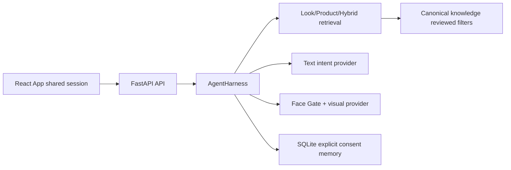

# TRACE V4 baseline audit — 2026-10-11

Baseline commit: 11a9202; development branch trace-v4-full-look. Existing dirty canonical accessibility_guidance/reference_cases/sources and DEVELOPMENT_STATUS are user work and preserved. User scripts trace_stage_softformal.py/trace_av_smoke_test.py retained, not rerun/imported. Private snapshots/incoming excluded from Git.

Backup: D:\AccessibleBeautyAgent\_backups\TRACE_V4_20261011_193205. Data copied non-destructively; SQLite snapshot made through sqlite backup API; source/UI, locks and local configuration backed up without displaying credentials. Verification JSON reports readable=true. Restore by copying selected files after stopping owned services, never overwrite the only database without confirmation.

Inputs: integration bundle present; UI ZIP 9 files, Markdown/JSON/TXT only, NO React source. Full Look ZIP 26 files, curated candidate metadata/prompts and 10 unreviewed images. SoftFormal seed present and already staged; no blind reimport. Data dictionary XLSX present. accessibility_evidence.xlsx exists in Downloads. Full local paper PDFs not yet located. Read extracted specifications as data; newer V4 instruction supersedes older stop-for-approval wording.

Baseline tests: backend 65 PASS with explicitly mock environment and project-local pytest basetemp; frontend 18 PASS, production build PASS. First attempted backend command incorrectly cleared pytest's configured project-local basetemp: 6 FAIL/24 fixture ERROR from out-of-project tmp paths; correcting the command restored all 65 without weakening path restrictions. No real remote call was made by tests.

Current policies: text intent has hardcoded system instructions in agent/providers.py; seed Markdown policies are NOT loaded at runtime. Visual provider receives validated image bytes through existing vision service. Remote vision/reading/reference remain mock in local settings. Language DeepSeek had prior successful text smoke; this audit does not equate text with vision.

Risks: transient sessions/refresh restoration; holding session lock across network request; inferred confidence not calibrated; no verified independent face Gold Set; no production authentication. Existing policy and admin filters remain authoritative. V4 will add presentation mode + typed plan to the same Session, a single FullLookService, reviewed/draft material dictionary and versioned runtime policies.
