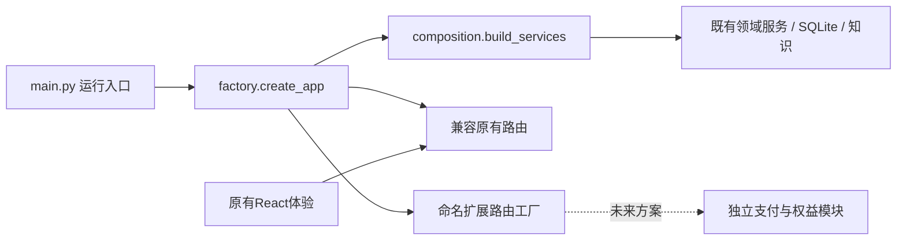

# TRACE-Next 架构与决策

## 决策

1. 保留 React/TypeScript/Vite 与 FastAPI/Pydantic/SQLite。当前工程已有领域边界与回归，赛事适配不要求无条件换栈；全量改语言将扩大风险而不产生收款能力。
2. 保留稳定领域逻辑、模型校验、SQL迁移和前端体验；这是有记录的代码复用。真正重构 backend/app/main.py 的职责：composition.py 构建服务容器，factory.py 组装 HTTP，main.py 仅为兼容启动入口并导出 create_app。导入 factory 不创建默认SQLite或模型实例，便于隔离验收和未来宿主。
3. ExtensionSpec 提供命名的路由工厂，工厂接收服务容器。扩展统一位于 /api/extensions/{name}，不允许通过名称逃逸覆盖现有接口；现有浏览器隔离/来源中间件仍包裹全部HTTP。命名空间只是挂载边界，不自动提供扩展对象所有权、商户身份或支付验签，未来模块必须单独实现和测试。
4. 不在本次迁移实现任何赛事特定交易。未来 commerce 扩展独立订单、支付通知验签、幂等、交付权益和退款状态；不得将模型文本或前端“支付成功”当真实回调，不得把匿名用户Cookie当生产付费账号。
5. 保持原有应用相对目录，避免破坏模型定位、前端代理与跨平台入口。新runtime默认5280/8112/8113，旧版5180/8012/8013可以并存。新私有数据库属于新目录，旧数据不自动搬运；下载权重按已有固定清单另装。

## 新旧对应与迁移批次

| 旧模块 | 新位置 | 处理 | 阶段检查 |
|---|---|---|---|
| config、schemas、memory、knowledge、rag、products、looks、content、services、data | 保持AccessibleBeautyAgent相对路径 | A 迁入基础依赖与示例数据，不含私有数据 | 知识校验、严格同意与签名版本、SQL迁移独立检查 |
| agent、vision、full_look、reading、routes、main | 领域路径不变，增加composition/factory/extensions | B 迁入互相引用的依赖闭包，重写组装边界 | 全量后端回归、新工厂扩展边界 |
| voice、hardware | 原相对位置 | C 迁入可选本地设备适配 | bounded语音测试、硬件回归；下载模型与实机另验 |
| frontend | 原相对位置 | D 保留UI及客户端契约 | vitest、类型检查、生产构建 |
| runtime、安装/启动器、交付检查 | 原相对位置，新默认端口 | E 隔离可执行入口 | 无模型启动/文字/重启/端口清理，核心契约对照 |

A—E按依赖顺序迁入，每组验证后继续。B包含HTTP依赖闭包是因为AgentHarness直接引用多领域服务；不以临时空实现假装各域可独立启动。源文件SHA记录 migration/port-manifest.json，新增/修改/原样复用逐项可复核。
