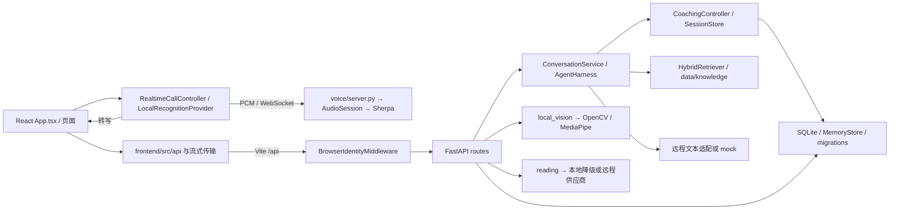

# TRACE 当前入口与数据流

阶段 0 记录于 `trace-baseline-20261107`。路线见 [整改计划](roadmap.md)，变更与退出条件见 [结构清单](architecture-cleanup.md)。

| 操作 | 实际入口 | 规则与存储 |
|---|---|---|
| 打开应用 | 外层 Mac / Windows 启动器 → `launch-portable.py` → Vite | 5180 网页、8012 API、8013 语音 |
| 文字、语音及流式回复 | `App.tsx` 的 `send`、`voiceTurn`，`/api/chat`、`/api/chat/stream` | `ConversationService` 和 `AgentHarness`，传输状态另见前端实时控制器 |
| 恢复、推进和总结 | `/api/session/{id}`、`/api/routine/*`、`/api/chat`、`/api/experience/reflect` | `SessionStore` 及 `CoachingController`，内存会话、SQLite 教学计划与旧进度字段 |
| 语音按钮和关键词 | `frontend/src/realtime` → `/local-voice/stream` | 浏览器采集，`voice/engine.py` 转写及关键词，应用播报由浏览器 TTS |
| 相机及观察 | 相机组件、`/api/chat` 相机授权、`/api/vision/local`、旧视觉入口 | `routes/local_vision.py` 的会话缓存、`LocalLandmarks`、`VisionService`；旧服务存在单独的远程图片条件 |
| Full Look 与比较 | FullLook / Reading 页及 `/api/full-look/*`、`/api/products/compare`、`/api/read` | `full_look/service.py`、`products/service.py`、`reading/service.py`；产品数据在知识 JSON |
| 日志及记忆 | Journal / BeautyMemory / LookRecollection，`/api/journal`、`/api/memory`、`/api/recollection` | `memory/store.py`、`recollection.py`、`migrations.py`；匿名浏览器 Cookie 隔离 |
| 知识库及课程 | `/api/rag`、`CoachingController`、知识管理页 | `KnowledgeStore`、`KnowledgeRepository`、`data/knowledge` 和配置词表 |
