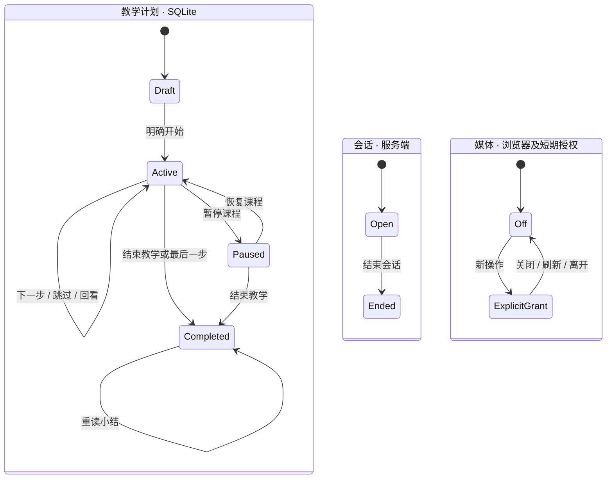

# 会话、教学和媒体状态边界

结束教学后仍可聊天；显式结束会话同时释放媒体。有教学计划的已结束会话在重启后仍保持结束。恢复、暂停和结束跨越媒体授权周期。声音暂停与课程暂停分开。已授予浏览器站点权限时，刷新仍不自动请求媒体。

教学按钮、文本、转写和旧路由都调用服务端命令事务。只有计划事务更新步骤，旧字段由后端从计划计算。React 采用服务端快照，正在处理的请求、语音和相机各自由协调模块负责。断连保留事件标识并查询既有提交。弃录不创建教学命令。
