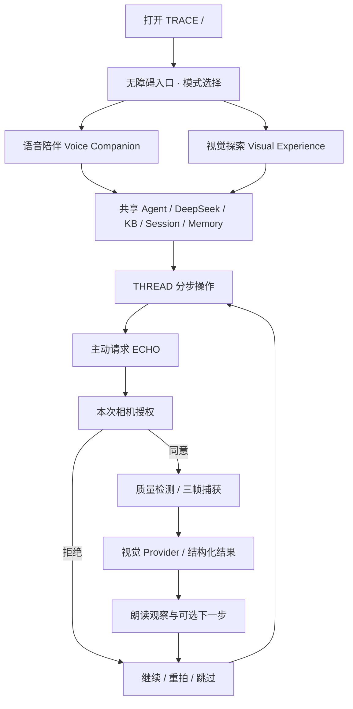

# TRACE / 听见你的美｜双模式入口与无障碍交互体验规范 V2

> 项目：L’Oréal Hackathon · Accessible Beauty Agent  
> 本版本用途：指导已经运行的 **React + Vite + FastAPI** 项目进行前端体验重构。  
> 核心方向：**一套 Agent / 两种进入美的方式 / 随时切换 / 始终无障碍**。  
> 当前范围：Dinner → Soft Formal → THREAD → ECHO → IMPRINT 的真实闭环；DOT 与 PAIR 保留入口，逐步完善。  
> 此文档是产品与交互设计决策，不代表代码已经实现或各设备验证通过。

---

## 0. 决策摘要

1. **不做残障身份核验**：不要求用户证明“是否视障/弱视”，也不将回答储存为健康身份标签。
2. **改成使用方式选择**：首页问“今天你希望怎样开始？”，提供**语音陪伴**和**视觉探索**。必要时允许“稍后再说”。
3. **两种体验共用 DeepSeek Agent**：相同 KB、会话状态、用户授权的 Memory、视觉工具和后端 API，避免双系统重复开发。
4. **语音陪伴不是空白页面**：极简大按钮、语音主导，但仍有文字输入、键盘、屏幕阅读器和可见状态；低视力用户可保留大字/高对比度视图。
5. **相机严格按需授权**：默认关闭；由用户主动请求或确认后，打开人脸质量检查、抓取三帧、调用视觉 Provider，并通过 TTS 读出结果；不承诺“连续实时动捕纠妆”。
6. **审美与操作分层**：文案可诗意，步骤指令必须具体、可执行；系统描述可观察状态，不对用户外貌打分。
7. **保留已有工程**：不从 React/Vite 重写到 Next.js，不重建 Agent/RAG/DB；目前候选数据仍是 DRAFT，未经审核不得自动提升为 VERIFIED。

### 为什么不按“你是不是视障人士”来分流

入口自我申报可以是可选偏好，但不能构成访问门槛：有人希望使用屏幕阅读器却不愿披露身体情况，也有低视力用户需要一定视觉信息。更可靠的决策变量是**交互方式**。产品可以问“你希望我主要用语音陪你，还是先看看页面？”并持续允许切换。

---

## 1. 结构：一个入口、两种 Experience Mode



推荐路由（可依据当前 `routes.ts` 灵活调整，避免破坏旧书签）：

| 路由 | 体验 | 主要内容 | 说明 |
|---|---|---|---|
| `/` | Entry | 选择 Voice / Explore | 旧 Home 内容迁移至 Explore |
| `/voice` | Voice | 一屏式对话 + 状态 + 操作按钮 | 进入后语音功能需用户激活 |
| `/explore` | Visual | 杂志式品牌首页 + Look/功能入口 | 旧视觉体验升级 |
| `/guide`（或复用 `/session`） | Shared | 当前 Soft Formal 步骤 | 保留旧路径兼容 |
| `/camera` | ECHO | 授权 → 预览 → 拍照 → 反馈 | 既可完整页面也可 Voice 内嵌面板 |
| `/read`（或保留 `/dot`） | DOT | 读取产品包装/文字 | 单独相机授权 |
| `/memory` | IMPRINT | 用户已确认的偏好 | 可随时删除 |
| `/story`, `/demo`, `/admin/*` | 原有 | 品牌故事、演示、开发后台 | 继续可访问 |

**规则**：Agent Session 不因切换入口而丢失；模式选择不重置 Look / Current Step；切换时停止活动中的录音/朗读，由用户重新激活麦克风。不要将单次语音交互与永久麦克风授权混淆。

---

## 2. 入口页 Entry（同时照顾第一次使用的视障者）

### 2.1 可见文案

- Logo：**TRACE · 听见你的美**
- Hero：**美，可以从听见开始。**
- Support：**让美的信息，在感官之间流动。**
- 主问题：**“今天，你希望我怎样陪你？”**
- 第一主操作：**「语音陪伴」** — “用声音告诉我你的想法。我会一步一步陪你完成。”
- 第二主操作：**「视觉探索」** — “探索妆容、造型与属于你的美学体验。”
- 其他入口：**「文字开始」**、**「使用说明」**（可选）
- 底部：**“任何模式都可以随时切换。”**

### 2.2 语音首问的真实执行边界

**不能假设普通浏览器可以在页面加载时自动播放语音或自动开启麦克风。**

默认体验：首次访问自动将**屏幕阅读器可读取的语义内容**放在页面上；用户点击/键盘确认“开启语音介绍”后，TTS 播放：

> “欢迎来到 TRACE。你想通过语音陪伴开始，还是先探索页面？可以说‘语音陪伴’或‘视觉探索’，也可以直接选择按钮。”

在明确点击麦克风并取得浏览器权限后才开始 ASR。听取单句后识别同义指令：

- `语音陪伴` / `用声音` / `我想直接聊天` / `听着操作` → VOICE
- `视觉探索` / `浏览页面` / `我想看看` / `普通界面` → EXPLORE
- `不知道` / `随便` / `再说` → 保持入口并给两个选项的说明，不根据声音或性别猜测视障身份

**不要**把“你是盲人吗？”作为强制第一问。用户如果主动提到“我是低视力/看不清”，只应将其用于**当前体验偏好**，不据此诊断程度或写入长期记忆。

### 2.3 无障碍行为

- 进入可正常 Tab 导航；主操作出现在前，显式 `aria-label`，无障碍说明可被屏幕阅读器获取。
- Voice 和 Explore 两张入口卡不是只有图像；使用明确按钮与副标题。
- 支持中文默认，可切换英文。
- 首屏不能靠粒子、闪烁或声音才能理解。
- 若 TTS/ASR 不可用，直接显示文字入口，不能死锁。
- 页面进入后一旦识别到现有系统屏幕阅读器朗读，不要重复自动播报同一段（不能可靠检测时，用用户选择控制朗读）。

---

## 3. Voice Companion — 面向语音优先使用

### 3.1 单屏核心 UI

视觉层级：

1. 页顶小型 TRACE 标记；“切换为视觉探索”和“无障碍设置”。
2. 中心有一个稳定的大型 Voice Orb / 轻缓六点呼吸符号（装饰性 dot 必须 `aria-hidden`）。
3. 当前明确状态：**等待你开始 / 正在聆听 / 正在理解 / 正在说话 / 操作暂停 / 等待授权**。
4. Agent 最新回复（大字，内容可选择完整或精简）。
5. 大触控区：**按下说话**、**重复**、**慢一点**、**下一步**、**帮我看看**、**停止**。
6. 文本输入备选项，始终可用；可折叠完整对话历史。

高对比文本、大面积操作、明确焦点，导航不超过必要项目。不要用传统多菜单商业网站布局，不要求用户先滚动找开始按钮。

### 3.2 理想第一轮对话

用户主动启动后：

Agent：“我在这里。今天准备去哪里？或者，你想先从什么妆容开始？”

用户：“今晚有一个 Dinner，我想正式一点，但不要显得太成熟。”

Agent：“可以从柔和、低饱和的 Soft Formal 开始。你希望先听完整思路，还是直接一步一步做？”

用户：“一步一步。”

Agent：“好。先从准备底妆开始。你准备好了就告诉我‘下一步’。”

关键原则：一次只给一个动作作为**默认**，允许用户要求整体概览；不要强制低速、不要幼儿化称呼。

### 3.3 命令词与恢复

| 用户命令 | 系统动作 | 反馈 |
|---|---|---|
| 下一步 / 继续 | 推进状态机一步 | 朗读新步骤 |
| 重复 / 再说一次 | 重播当前步骤，不重触发动作 | 不重复写入 Memory |
| 慢一点 | 降低播报速度、拆分指导 | 用户可恢复正常 |
| 为什么 | 讲依据、效果和适用边界 | 当前步骤上下文不丢失 |
| 帮我看看 | 请求 ECHO | 必须询问相机授权 |
| 不用了 / 跳过 | 退出当前可选检查 | 回到 THREAD |
| 停止 | 立即取消 TTS、ASR、相机流 | 会话安全结束 |
| 切换页面 / 视觉探索 | 切换显示模式 | 当前 Look / Step 保留 |

失败恢复：ASR 听错 → 展示/朗读“我听到的是……对吗？”（关键操作时）；音频未识别 → 轻量重试或文字输入；网络超时 → 保留当前步骤并允许重试；重复按按钮防止并发请求。

---

## 4. Visual Experience — 面向视觉探索的高保真品牌 UI

从旧版文件中继承：Ivory/Warm White/Oat/Blush Mist/Espresso 调色体系、Noto Serif SC / Cormorant Garamond 标题、12 栏非对称杂志式布局、Digital Scent 粒子隐喻、留白与柔和卷动。此部分**不作为 Voice Mode 的强制访问路径**。

页面建议：

- Hero：TRACE · 听见你的美 · Beauty, translated across senses.
- 今日状态 / Today's Mood：用自然语言起步；Dinner / Soft Formal 的默认演示场景。
- Explore Looks：已审核 Look 的视觉卡片；标注 DRAFT 不可用于正式推荐。
- Pair / Choose：真实已审核产品的双方案对比。
- Dot / Read：镜头读取包装与色号，明确识别可能失败。
- Styling：妆容 / 发型 / 配饰 / 穿搭 / 香气作为可扩展栏目；未接真实数据时不展示为已推荐结果。
- Imprint：经用户许可的审美偏好日记。
- Start Voice：全程可跳转 Voice Companion。

视觉主题“Luxury × Editorial × Romantic × Soft Technology”；动效仅在 Explore 上逐步增强。遵循 `prefers-reduced-motion`、WCAG AA 文本对比、键盘和屏幕阅读器支持。

---

## 5. ECHO：相机 / Face Landmark / Visual Understanding / TTS

### 5.1 定义“动捕”的边界

比赛版优先做 **face landmarks + pose/quality gate + user-triggered still captures**。这属于轻量面部跟踪/视觉质量辅助。**不要宣称已经实现连续实时动捕、精确手部轨迹纠妆或微小腮红差异测量。**

```text
语音提出检查请求
→ Agent 对当前步骤建议检查（可拒绝）
→ 听觉/可见的本次 Camera Consent
→ 浏览器 getUserMedia 开启视频预览
→ MediaPipe / OpenCV 人脸数量、姿态、遮挡、光照质量门控
→ 用户主动“拍照确认”
→ 抓取三帧，停止流（不保留连续原视频）
→ Provider 接收被授权的画面
→ 结构化 VisionReply（证据、status、不确定字段）
→ Rules/Policy 校验（不足则 UNCERTAIN）
→ 中文文字 + TTS 描述观察
→ “继续 / 重拍 / 跳过”
```

一部分已由现有项目实现；实际模型的图像支持、请求格式和返回约束必须用真正的 API 请求核验。`confidence` 不能被视为已校准概率，三张连续帧高度相关，不能假装三次独立验证。

### 5.2 边界与状态

- 初期**唯一必测视觉任务**：`blush_presence`；`NO_BLUSH | LEFT_ONLY | RIGHT_ONLY | BOTH | UNCERTAIN`。
- 始终采用**用户本人的左/右**；镜像预览只影响显示，不影响语音方位；必要时在测试中核对。
- 无足够依据 → **“我现在还不能可靠判断。可以转正一点、调整光线后再试一次；也可以跳过检查。”**
- 不能用脸型、肤色或妆效完成度给人打美貌分数。
- 摄像头和 TTS 应有明确 Stop 控件。
- 读取外部屏幕/包装属于 DOT；屏幕阅读器兼容属于 App 自身无障碍，二者不能混为一谈。

### 5.3 真正的隐私承诺需要代码配套

如果图像要发送给第三方模型，授权说明必须明确提及；不能简单写“照片从不出设备”。原图存储策略、服务器日志与第三方提供商处理政策必须与实际配置一致；未核查前避免绝对化保证。

---

## 6. 交互 Prompt 分层

1. **Base System Policy**：尊重、自主、能力边界、工具调用、Camera / Memory consent。
2. **Interaction Mode Policy**：Voice 模式默认简短、可重复、流程优先；Visual 模式可显示更多卡片和细节，但回答不能同一问题相互矛盾。
3. **THREAD Guidance Policy**：Normal / Slow / Repeat / Why / Spatial Language / Skip。
4. **ECHO Visual Feedback Policy**：Observed / Uncertain / Optional Action；视觉声明只能来自真实 Tool 结果。
5. **Look & Routine KB**：经过人工审核的 Soft Formal 真实知识，RAG 获取后与来源绑定。

注意：Markdown 在仓库里**并不会自动生效**。必须通过 Agent 运行时 Prompt Loader / policy wiring 验证规则实际载入。

---

## 7. 页面状态、语音权限与用户选择

| 状态 | 用户可感知反馈 | 动作 | 不可做的事 |
|---|---|---|---|
| Entry idle | 两种模式名称与说明 | 点选/键盘 | 假定盲人身份 |
| Voice not activated | “开启语音陪伴” | 点击或键盘激活 | 自动开麦 |
| Microphone denied | “可以使用文字输入” | 重试/文本 | 锁死流程 |
| Listening | “正在聆听” | 停止录音 | 未经许可长期开麦 |
| Thinking | “正在理解” | 停止/等待 | 伪装真实响应 |
| Speaking | “正在朗读” | 暂停/重复 | 强制播放不允许停止 |
| Camera consent | “这次需要相机吗？” | 同意/拒绝 | 自动打开 |
| Camera quality failed | “光线或角度不够清楚” | 重拍/跳过 | 随便猜测 |
| Vision uncertain | “我不能可靠判断” | 重试/继续 | 给确定性补妆命令 |
| TTS failed | 同样呈现可访问文字 | 手动重读/文本 | 阻断下一步 |
| Switch mode | 语音停止，进度保留 | 切换 | 清空 Session |

---

## 8. 现有源码改造地图（基于已上传项目副本）

| 现有文件/模块 | 预期修改 |
|---|---|
| `frontend/src/App.tsx` | 将 `/` 改为 Entry，协调两个界面模式；保持现有共享 Session、API 客户端与所有 consent 逻辑 |
| `frontend/src/state/routes.ts` | 新增/兼容 `/voice`, `/explore` 与旧路由；Back/Forward 正常 |
| `frontend/src/pages/Home.tsx` | 原首页迁往 Visual Experience，或抽取共用模块卡 |
| 新建 `frontend/src/pages/Entry.tsx` | 语音引导与模式选择；无鉴别/诊断 |
| 新建 `frontend/src/pages/VoiceCompanion.tsx` | 单屏语音会话，不重复创建第二个 Agent Session |
| `frontend/src/realtime/voice.ts` | 复用 PushToTalkProvider，补首屏权限/文本 fallback；避免并发启动 |
| `frontend/src/accessibility/useSpeech.ts` | 复用 TTS，控制中断、速度、朗读互斥 |
| `frontend/src/pages/CameraCheck.tsx` | ECHO 作为 Voice 内可返回的任务流程；复用相机与三帧捕获 |
| `frontend/src/pages/Reading.tsx` | 保留 DOT，单独授权 |
| `frontend/src/content/Locale.tsx`, `traceBrand.ts` | 双语入口、模式、权限与错误文案集中管理 |
| `frontend/src/styles/trace.css`, `traceTokens.css` | 交互模式分别做简化和视觉美学层 |
| `backend/app/**`, KB/RAG/Agent | 只做必需接口适配或 Prompt Loader 接入，不做重写 |

**旧版 UI 文档推荐 Next.js、GSAP、Three.js，但当前源码依赖是 React 19 / Vite 7；不要因为设计规范而迁移框架。** 动效可以用轻量 CSS 先实现。 

---

## 9. 测试与验收门槛

### P0：先保证实际可用

- 初次访问无自动要求诊断或证明身份；点击、键盘、系统屏幕阅读器都能选择模式。
- 浏览器拒绝麦克风权限后仍能用文字继续；不自动播放无法阻止的声音。
- Voice 模式可以完成 Dinner/Soft Formal 的文本端到端对话，且可朗读回复。
- 开启 ECHO 必须本次明确 Camera Consent；拒绝时可继续指导。
- 相机抓帧后有真实质量检查、Provider 状态与模拟标签准确披露；失败可重拍/跳过。
- 模式切换不丢当前选中的 Look、当前步骤和允许保存的偏好。
- 入口及 Voice 的主要控件通过键盘、TalkBack/NVDA 或 VoiceOver 至少一次实机走查。
- 现有 59+ 后端/7+ 前端测试等按本地最新基线执行，不凭旧报告宣称新测试通过。

### P1：Demo 视觉与品牌

- Explore 展示旧版高保真风格：Editorial、浅暖色、非对称网格、留白、轻粒子、Soft Formal。
- Voice 模式不强制加载 Three.js/复杂背景；首屏交互速度、读屏清晰度优先。
- 动效对 reduced motion 自动降级。
- 开发后台、RAG、Mock 控件不暴露在普通用户视图。

### P2：后续迭代

- 多语言正式盲文转译及专家复核（品牌点阵几何不等于真实 Braille）。
- 实机 ASR/TTS 更换与降级策略。
- 视觉模型质量验证：含光照、角度、肤色、设备变化的独立人工标注数据集。
- 目标用户测试后调整模式命名、首问与快捷动作。

---

## 10. 晚上交给 Codex 前的冻结条件

先完成并记录：入口可进入、Voice 能工作、原有 Demo 不回归、关键权限明确、后端接口仍可用、当前 DRAFT 数据未被误标 VERIFIED。冻结这一基线，再让 Codex 单独优化 Explore 的审美和 Voice 的微交互。

**一句话产品定义**：TRACE is one accessible beauty companion, with two ways to enter: by voice or by exploration. The user chooses the channel; the Agent translates the information.

